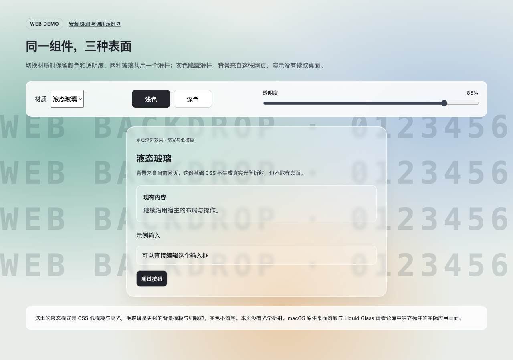
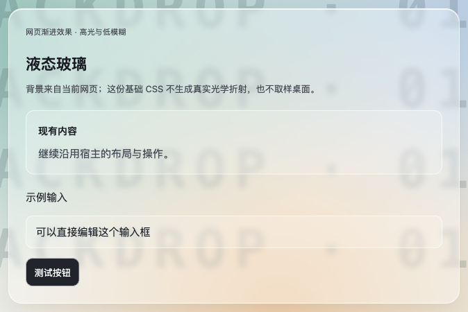
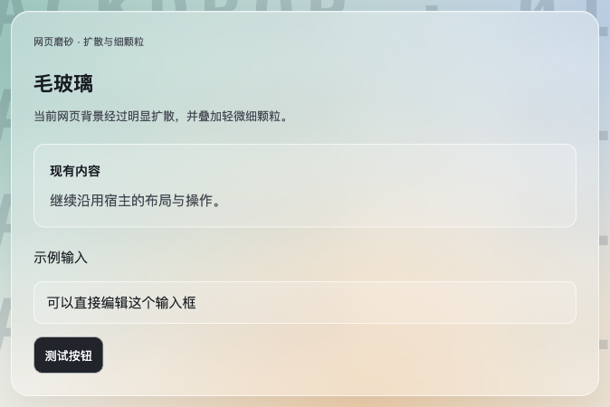
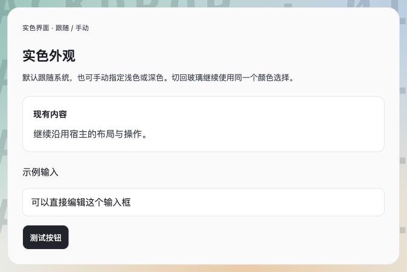
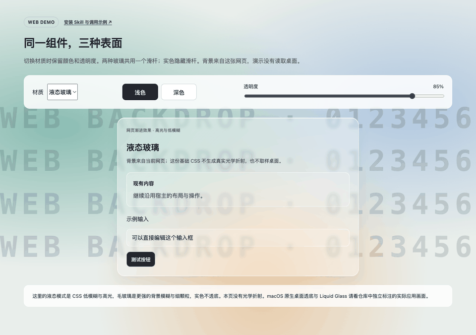
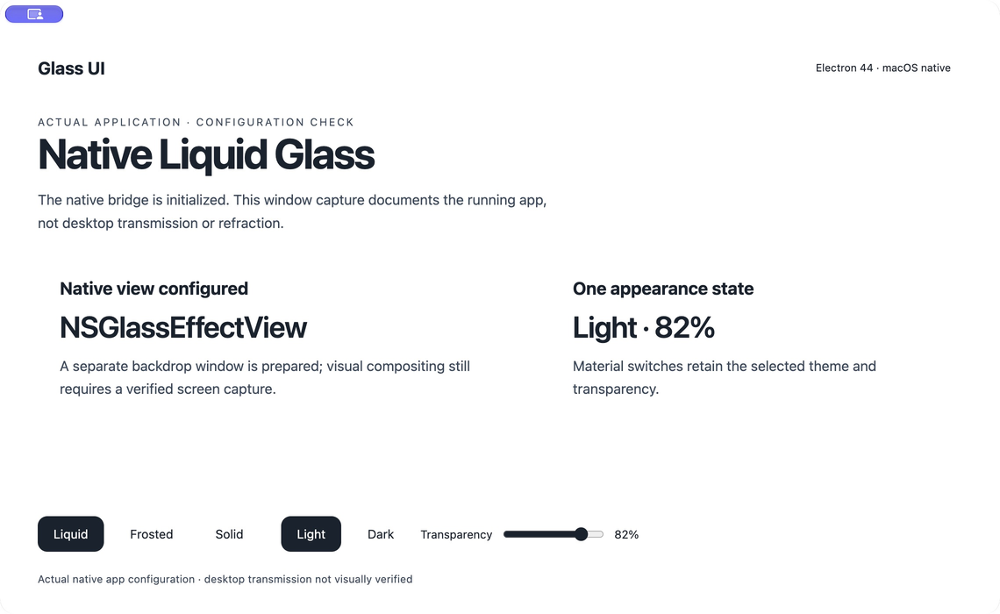

# Glass UI · 液态玻璃与毛玻璃界面 Skill

为已有网页、桌面应用或局部组件加入玻璃材质、浅深色和统一透明度控制，保留原有功能与布局。

**[▶ 在线体验：切换材质、主题与透明度](https://yemin11238.github.io/glass-ui/assets/web/demo.html)** · [快速安装](#安装) · [直接调用](#开始使用)



| 液态玻璃 · Web 基础效果 | 毛玻璃 · Web | 实色界面 · Web |
| --- | --- | --- |
|  |  |  |
| 低模糊、较清透、高光边缘 | 强扩散模糊、轻颗粒、柔和边界 | 不透明，跟随系统或手动浅深色 |



图片和动图来自本仓库演示页的实际运行。**网页演示只处理网页内的背景**：基础液态模式提供 CSS 高光与低模糊，没有光学折射，也不读取桌面。动图展示同一个组件切换三种材质、浅深色和共用透明度。

## 可以用在哪里

- 给现有卡片、侧栏或设置弹窗加玻璃外观，保留业务操作与布局。
- 两种玻璃共用一个透明度值，切换材质保留颜色；实色隐藏滑杆但保留设置区域尺寸。
- 跟随系统或手动浅色、深色，只显示当前材质适用的一组颜色选择。
- 为 Electron macOS 窗口接入系统原生材质；原生桌面透底需单独验证。

## 安装

需要能读取本地 Skill 的 Codex。复制下面整段到终端；已有同名技能会移到 `skills` 目录外保留，再克隆完整仓库：

```bash
skill_root="${CODEX_HOME:-$HOME/.codex}"
skill_target="$skill_root/skills/glass-ui"
if [ -e "$skill_target" ]; then
  mkdir -p "$skill_root/skill-backups"
  mv "$skill_target" "$skill_root/skill-backups/glass-ui-$(date +%Y%m%d-%H%M%S)-$$"
fi
mkdir -p "$skill_root/skills"
git clone https://github.com/YEMIN11238/glass-ui.git "$skill_target"
```

重新打开 Codex 或开始新会话，用 `$glass-ui` 调用。备份不会作为第二个同名 Skill 被发现。

也可下载 ZIP，把完整目录保存为 `~/.codex/skills/glass-ui/`；设置了 `CODEX_HOME` 时使用该目录下的 `skills/glass-ui/`。**不要只复制 `SKILL.md`**，保留相对结构：

```text
glass-ui/
├── SKILL.md
├── agents/openai.yaml
├── references/
└── assets/
    ├── web/
    └── electron-macos/
```

## 开始使用

复制任一请求到 Codex，并附上目标项目或组件。

**卡片**

```text
使用 $glass-ui，把当前页面的卡片改成毛玻璃。
保留表单与按钮行为，只作用于卡片；加入浅深色和透明度控制。
```

**侧栏**

```text
使用 $glass-ui，给当前应用侧栏加入液态与毛玻璃切换。
保留导航和布局，两种玻璃共用一个透明度值，切换材质保留主题。
```

**设置弹窗**

```text
使用 $glass-ui，改造当前设置弹窗。
提供液态玻璃、毛玻璃、实色；只有一组颜色按钮和一个玻璃透明度滑杆。
切换时弹窗尺寸与选框位置保持稳定，保留键盘操作。
```

**Electron macOS 原生窗口**

```text
使用 $glass-ui，为这个 Electron macOS 应用接入原生桌面透底。
保留已有功能、窗口按钮和布局，统一保存材质、主题与透明度。
检查系统与 SDK，不支持原生液态玻璃时使用毛玻璃或实色降级。
```

Skill 提供接入规则与可复制资产，需要结合你的项目实施；它不会自动安装 Electron、替换应用框架或开启系统权限。

## macOS 原生接入 · 实际应用与验证边界



这是实际运行的隔离 Electron 应用，与网页演示分开。**本次窗口截图未呈现后方测试背景，不能用它证明桌面透底或折射质感。** 原生桥构建、材质视图、主题继承和透明度控件已检查；实际合成画面的视觉验证仍待补充，不将灰底截图当成效果成功。

测试环境与采集边界见 [演示素材说明](assets/readme/README.md)。

## 平台支持

| 平台 | 提供什么 | 要求与降级 |
| --- | --- | --- |
| Web / React / Vue / Svelte / 普通 HTML | 有作用域 CSS、无框架控制器、网页内背景模糊 | 依赖 `backdrop-filter`；不支持时回退实色。基础液态模式没有光学折射。 |
| Electron macOS | 原生桥源码、外观适配器、窗口按钮维护 helper | 原生液态需 macOS 26+；构建需 26+ SDK、clang++、Node N-API 头文件及匹配架构。旧系统按目标 Electron 能力选择毛玻璃或实色。 |
| Tauri / 原生 macOS / 其他桌面框架 | 可复用统一状态与视觉规则 | 原生部分需用宿主自身接口适配；不能直接复制 Electron 句柄或 IPC。 |
| Windows / Linux | Web 组件效果与实色降级 | 本仓库没有提供或验证整窗原生透底桥，需单独适配。 |

**CSS 背景模糊**采样网页内部；**原生透底**由系统处理窗口后方；**光学折射**需要支持它的原生材质或额外 Web 实现。三者不是同一种能力。可选的 `liquid-glass-react` 可用于网页内折射，但本仓库没有打包或自动安装它。

## 接入与排查

- [网页组件、参数与控制器](references/web-components.md)
- [Electron macOS 接入与原生窗口限制](references/electron-macos.md)
- [验收与常见故障](references/verification.md)
- [来源与许可证](references/provenance-and-license.md)

本地演示：在仓库根目录运行 `python3 -m http.server 8765 --bind 127.0.0.1`，打开 `http://127.0.0.1:8765/assets/web/demo.html`。

## 许可证

原创说明、模板和演示素材采用 [MIT](LICENSE)，允许使用、修改和分发，保留版权与许可声明。第三方内容保留各自许可，详见 [第三方声明](THIRD_PARTY_NOTICES.md)；参考接口与资料的许可不会自动套给本 Skill。
